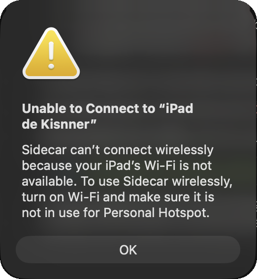
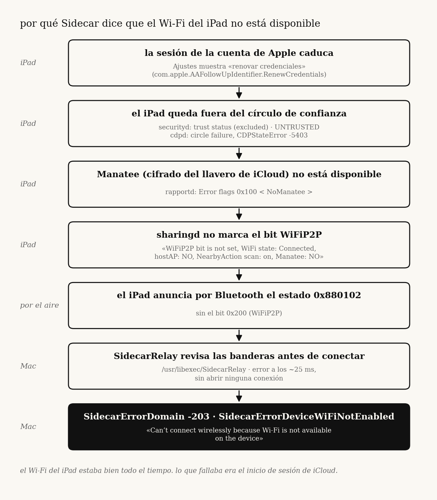
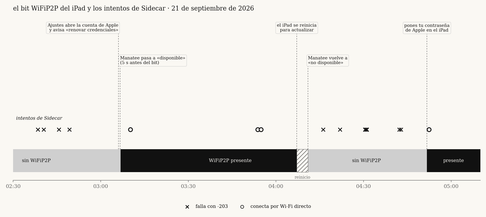

<p align="center"></p>

# sidecar-wifi-macos27

**[versión en español](README.md)** · **[full writeup](writeup.md)**

why sidecar says your ipad's wi-fi is not available when the wi-fi is fine. **solved.**

the error, verbatim: *"Unable to Connect to 'iPad'. Sidecar can't connect wirelessly because your iPad's Wi-Fi is not available. To use Sidecar wirelessly, turn on Wi-Fi and make sure it is not in use for Personal Hotspot."* in the mac log: `SidecarErrorDomain Code=-203 "SidecarErrorDeviceWiFiNotEnabled"`. sidecar over usb cable still works.

<sub>real screenshot, macbook pro on macos 27.2 and ipad pro on ipados 27.</sub>

## the cause

wi-fi was never the problem. the apple account session on the ipad had expired (settings showed "renew credentials"). with the session in that state, icloud keychain (manatee) becomes unavailable, and the ipad, by design, **stops advertising the `WiFiP2P` bit over bluetooth**. the mac reads that, and aborts with `SidecarErrorDomain -203` after 25 ms, before trying to connect to anything. the message the system shows is misleading.

<p align="center"></p>

## the fix

on the ipad, finish the apple account prompt:

1. **settings → your name**: if it asks you to "update apple account settings" or to sign in again, complete it (password, verification code, ipad or iphone passcode if asked).
2. **icloud → passwords & keychain**: must be on.
3. if it still fails: sign out of the account on the ipad and sign back in.

what does **not** help: toggling wi-fi or bluetooth, restarting, switching wi-fi band, turning off the vpn, charging the ipad, or updating the system.

## if it comes back

it happened again on 20 November 2026 with nothing else changed: `sidecar-probe status` said `SIN WiFiP2P` (no WiFiP2P bit) and the iPad's own logs said `WiFiP2P bit is not set, WiFi state: Connected, … Manatee: NO` together with `Manatee not available … CDPStateError -5403`. the iPad's Wi-Fi was connected. after resetting the iPad's iCloud session, the status flipped to `WiFiP2P presente` and Sidecar worked again. the full diagnosis is three commands: `sidecar-probe status`, `devicectl list devices` for the real UDID, and `ipad-why.sh`.

to get the UDID of the iPad connected by cable:

```bash
xcrun devicectl device info details --device <identifier from devicectl list devices> | grep UDID
```

## the proof

the ipad's bit, measured every second from the mac, against each attempt to connect. every successful connection falls inside a window where the bit is present; every failure falls outside.

<p align="center"></p>

- at **03:06** the ipad showed an icloud alert asking for the ipad passcode and then the iphone's; 5 s after manatee turned "available", the bit appeared and sidecar connected.
- at **04:07** the ipad restarted for an update, asked for the account password again, and the bit disappeared again.
- at **04:51** the password was entered, the bit came back and sidecar connected over direct wi-fi.

all of this comes from the ipad's own logs, not guesses: [notes/investigacion.md](notes/investigacion.md) (in spanish).

## diagnose it on your mac

```bash
swiftc -O tools/sidecar-probe.swift -o sidecar-probe
./sidecar-probe status      # does the ipad advertise WiFiP2P? (exit code 0 if yes, 3 if no)
./sidecar-probe watch       # prints every change of the bit
./sidecar-probe connect     # tries to connect and prints the exact error
```

to see from the ipad side why it doesn't advertise it (needs a cable and an admin password):

```bash
sudo log collect --device-udid <UDID> --last 10h --output /tmp/ipad.logarchive
sudo chown -R "$USER" /tmp/ipad.logarchive
./tools/ipad-why.sh /tmp/ipad.logarchive
```

the output masks emails, account identifiers, udid and addresses. the original logs contain personal data: delete them when you're done.

## what's here

| | |
|---|---|
| [notes/investigacion.md](notes/investigacion.md) | timeline, discarded hypotheses with their evidence, cause and limits (spanish) |
| [notes/arquitectura.md](notes/arquitectura.md) | how sidecar decides: `SidecarRelay`, `rapportd`, `sharingd` (spanish) |
| [evidence/](evidence) | masked excerpts of the ipad and mac logs |
| [tools/](tools) | `sidecar-probe` (private `SidecarCore` api) and `ipad-why.sh` |

## limits

- tested on a macbook pro (`MacBookPro17,1`, macos 27.2, `26B5086k`) with a 12.9" ipad pro 5th gen (`iPad13,10`, ipados 27.0 and 27.2). i don't know if it applies the same way to other models.
- `sidecar-probe` uses a private apple api: it's for diagnosis only and may stop working without notice.
- i didn't capture the ipad logs at the exact moment the password was entered (04:51); that moment is only observed from the mac.
